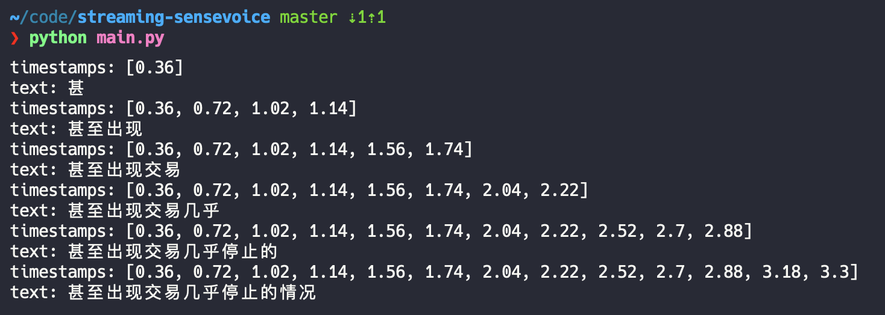

# streaming-sensevoice

Streaming SenseVoice processes inference in chunks of [SenseVoice](https://github.com/FunAudioLLM/SenseVoice).

## Usage

- transcribe wav file

```bash
$ python main.py
```



- transcribe from microphone

```bash
$ python realtime.py
```

- transcribe from websocket

A basic WebSocket service built with [`Recorder`](https://github.com/xiangyuecn/Recorder) and `FastAPI`; the frontend uses `MP3` format to transmit audio information to reduce latency and increase stability.

```bash
pip install -r requirements-ws-demo.txt
python realtime_ws_server_demo.py

# check cli options
python realtime_ws_server_demo.py --help
```

Then open <http://127.0.0.1:8000/> in your browser and click `Start Recording`.

Notes:

- The page is served by the demo server. Do **not** open `realtime_ws_client.html` directly as a file — the WebSocket address is derived from the page host, so it only works when accessed via `http(s)://<server>/`.
- Browsers only grant microphone access on `localhost` or HTTPS pages. For remote access, serve behind HTTPS or use an SSH tunnel.
- The page loads the Recorder library from jsdelivr CDN; make sure the CDN is reachable (or vendor `recorder-core.js`, `engine/mp3.js`, `engine/mp3-engine.js` locally).
